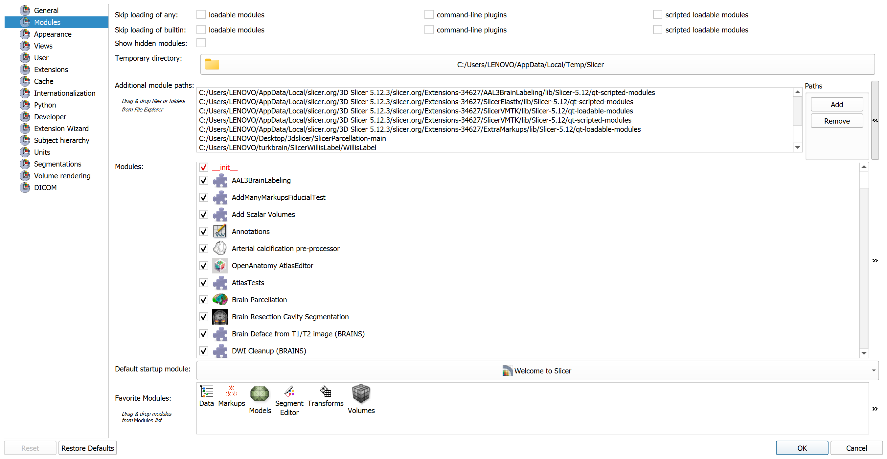
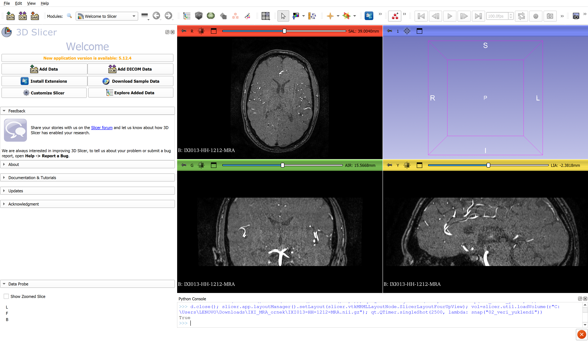
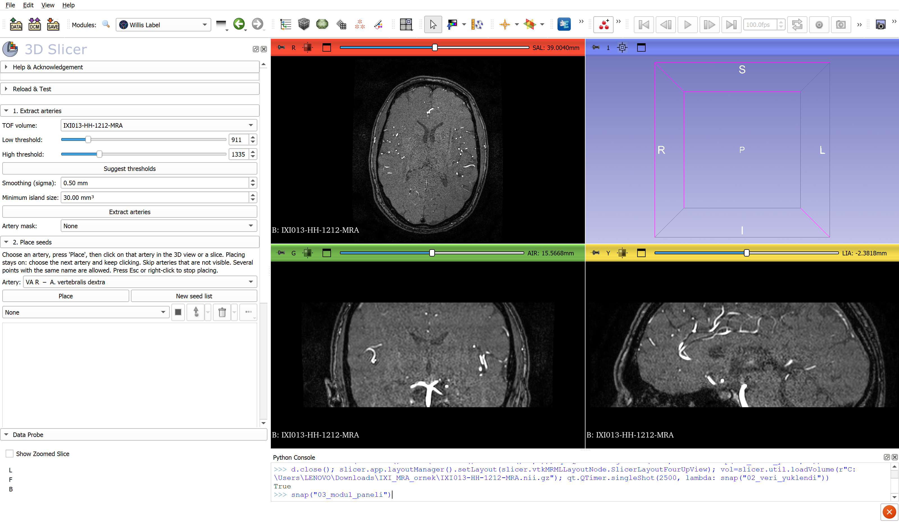
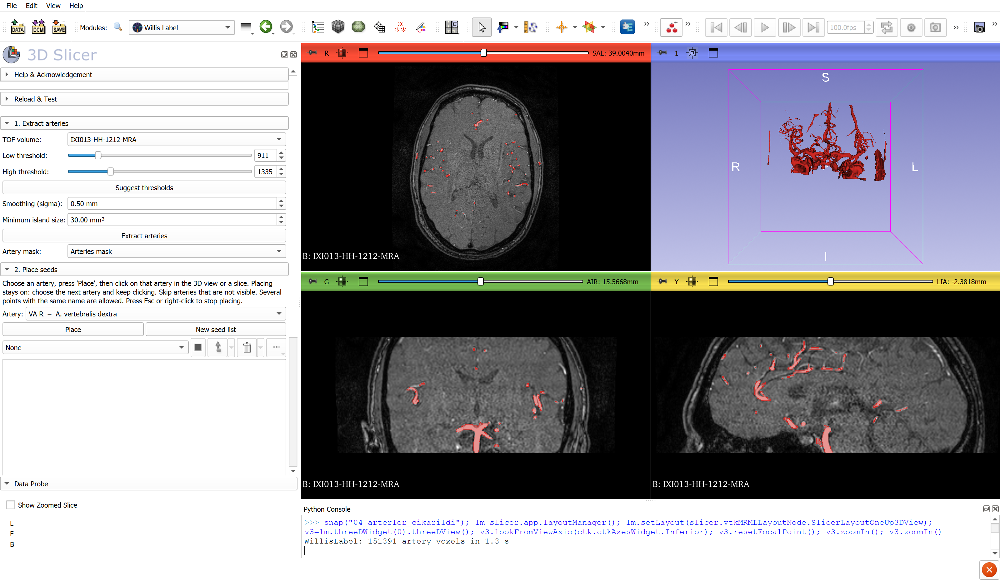
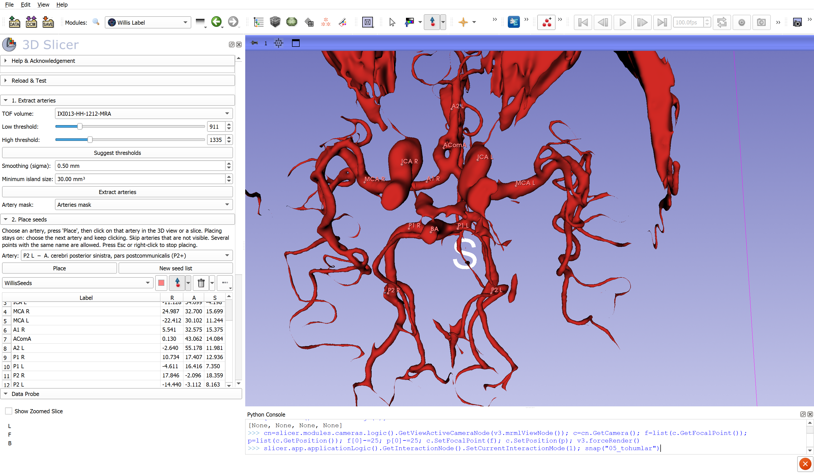
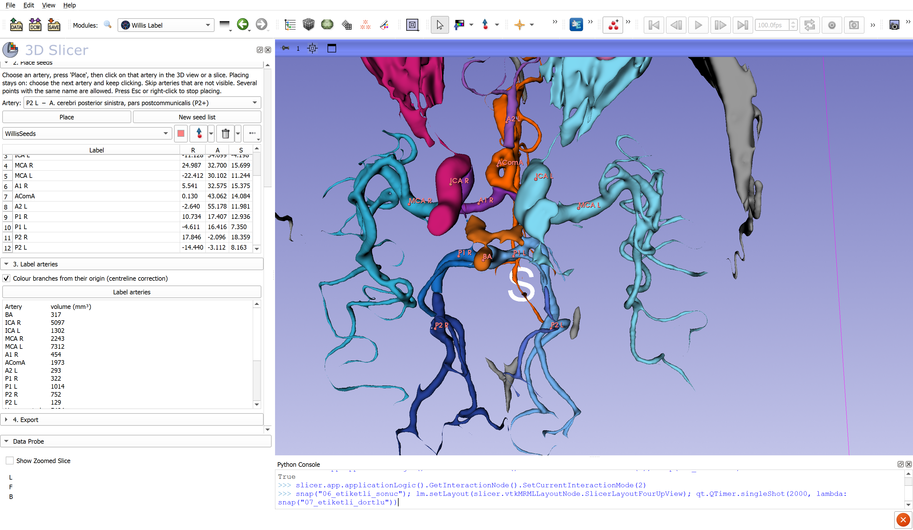
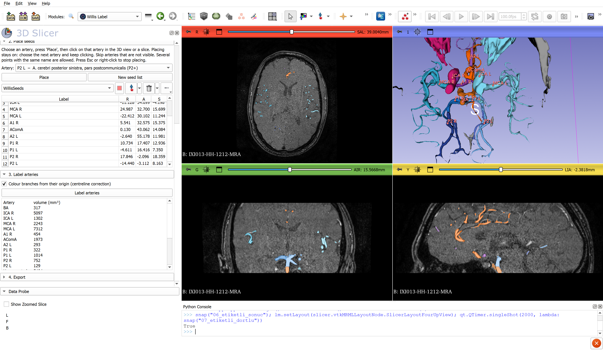

# Willis Label – Adım adım kullanım kılavuzu

Örnek veri: IXI013-HH-1212-MRA (IXI veri seti, CC BY-SA 3.0, https://brain-development.org/ixi-dataset/).
Slicer sürümü: 3D Slicer 5.12.3.

> Geliştirme sürümü. Modül henüz Extension Manager'da yok, bu yüzden klasör olarak elle ekleniyor (Adım 1).

---

## Adım 1 – Modül yolunu ekleyin (yalnızca bir kez)

**Edit → Application Settings → Modules** bölümüne gidin. **Additional module paths** kutusunun sağındaki **»** düğmesine basın, ardından **Add**'e basın.

Açılan pencerede dıştaki `SlicerWillisLabel` klasörünü değil, onun **içindeki `WillisLabel` klasörünü** seçin. Doğru klasörün içinde `WillisLabel.py` dosyası ve `WillisLabelLib` klasörü bulunur. Örnek:

`C:\Users\LENOVO\Desktop\SlicerWillisLabel\WillisLabel`

**OK** deyip Slicer'ı kapatıp yeniden açın.

> Klasörü daha sonra başka bir yere taşırsanız bu yolu da güncellemeniz gerekir. Eski yol listede kalırsa Slicer modülü bulamaz ya da eski kopyayı yükler.

> **GitHub'dan ZIP olarak indirdiyseniz:** GitHub klasörü `SlicerWillisLabel-main` adıyla açar. Bu durumda eklenecek yol `...\SlicerWillisLabel-main\WillisLabel` olur.

> **scipy hatası alırsanız:** Modül numpy ve scipy kütüphanelerini kullanır. Geliştirme yapılan bilgisayarda ikisi de Slicer'da hazır bulunuyordu. Slicer'ın temiz bir kurulumunda scipy'nin hazır gelip gelmediği henüz başka bir bilgisayarda denenmedi. Modül açılırken ya da çalışırken `No module named 'scipy'` gibi bir hata görürseniz **View → Python Console**'a şunu yazıp Enter'a basın:
>
> ```
> slicer.util.pip_install('scipy')
> ```
>
> Kurulum bitince Slicer'ı yeniden başlatın.

Listenin en altında `.../SlicerWillisLabel/WillisLabel` satırı görünmelidir:



## Adım 2 – TOF-MRA görüntüsünü açın

**File → Add Data** (ya da sürükle-bırak) ile TOF görüntüsünü yükleyin (`.nii.gz`, `.nrrd` ya da DICOM).



## Adım 3 – Modülü açın

Araç çubuğundaki **büyüteç** simgesine tıklayın, **Willis** yazın ve **Switch to module**'e basın. Modül, *Segmentation* kategorisinde **Willis Label** adıyla da bulunabilir.

Panelde dört bölüm vardır: *1. Extract arteries*, *2. Place seeds*, *3. Label arteries* ve *4. Export*.



## Adım 4 – Arterleri çıkarın

*TOF volume* kutusunda görüntünüz seçili olmalı. Eşik değerleri otomatik olarak önerilir: bu olguda **Low 911 / High 1335**. **Extract arteries**'e basın. Birkaç saniye içinde damar ağacı kesitlerde kırmızı olarak görünür ve *Artery mask* kutusuna `Arteries mask` gelir.



**Dikkat:** TOF'ta yağ dokusu da parlak görünür. Orbita yağı ve kafa derisi maskeye girebilir. Gerekirse *Segment Editor*'de silebilirsiniz.

## Adım 5 – 3B görünümü hazırlayın

Willis halkası en iyi alttan (**inferior**) görünür. 3B pencerenin üst şeridindeki **raptiye (📌)** simgesine tıklayın, yön düğmelerinden **I**'yı seçin ve fare tekerleğiyle yakınlaşın. Bu görünümde üst taraf anteriordur ve **ekranın solu hastanın sağıdır**.

## Adım 6 – Tohum noktalarını yerleştirin

1. **Artery** listesinden arteri seçin (örneğin `BA – A. basilaris`). Liste açıkken kısaltmayı yazmak (`ICA R`, `P1 L`…) doğrudan o satıra götürür.
2. **Place**'e basın ve 3B görünümde (ya da kesitte) o arterin üzerine tıklayın. Nokta, seçili arterin adını otomatik olarak alır.
3. Listeden sıradaki arteri seçip tıklamaya devam edin. Yerleştirme modu açık kalır, her seferinde Place'e basmanız gerekmez.
4. Görünmeyen arterleri atlayın. Bitince **Esc**'ye basın.

Tablodaki **R** sütunundan tarafı kontrol edin: **pozitif = sağ, negatif = sol**. Yanlış adlandırılmış bir noktayı tablodaki adına çift tıklayarak düzeltebilirsiniz.

Bu örnekte 12 nokta yerleştirildi: BA, ICA R/L, MCA R/L, A1 R, AComA, A2 L, P1 R/L, P2 R/L.



## Adım 7 – Etiketleyin

**3. Label arteries** bölümünde **Label arteries**'e basın. Her arter Latince adı ve kendi rengiyle ayrı bir segment olur. Alttaki kutuda her arterin hacmi (mm³) ve tohum konmamış arterlerin listesi yazar.





## Adım 8 – Dışa aktarın (3B baskı için)

**4. Export** bölümünde bir klasör seçin ve **Export each artery as STL**'e basın. Her arter ayrı bir STL dosyası olarak kaydedilir.

---

## Ek: TopCoW modeliyle otomatik tohumlama (isteğe bağlı, ileri kullanıcılar için)

[TopCoW](https://topcow24.grand-challenge.org/) yarışmasının modelleri Willis halkasını (ICA, MCA, A1/ACA, AComA, PComA, P1/PCA, BA, 3. A2) otomatik olarak etiketler. Willis Label bu etiketleri **otomatik tohum** olarak kullanabilir. Bu durumda Willis halkası için elle nokta koymak gerekmez; yalnızca TopCoW'un tanımadığı damarlara (VA, SCA, AICA, PICA) nokta koyulur. Rapor ayrıca halkanın her parçasının görüntülenip görüntülenmediğini yazar.

> **Kurslar için öneri:** Bu bölüm Docker kurulumu gerektirir. Kurulum yarım saati bulabilir ve çoğu kursiyerin bilgisayarında Docker yoktur. Kursta en pratik yol, eğitmenin TopCoW çıktısını (`..._TopCoW` etiket haritası) önceden hazırlayıp TOF görüntüsüyle birlikte dağıtmasıdır. Kursiyer yalnızca bu dosyayı **etiket haritası** (label map) olarak yükleyip *TopCoW labels (optional)* kutusunda seçer.

### Bilgisayar gereksinimleri

| Gereksinim | Not |
|---|---|
| Windows 10/11, 64 bit, WSL 2 | Docker Desktop WSL 2 üzerinde çalışır |
| **Docker Desktop** | Aşağıda kurulumu anlatılıyor |
| **NVIDIA ekran kartı** (güncel sürücüyle) | Denenen: NVIDIA GeForce RTX 40 serisi dizüstü kartı. Olgu başına yaklaşık 2 dakika |
| RAM | Denenen bilgisayarda 64 GB vardı. En az 16 GB önerilir; model 8 GB paylaşımlı bellek ayırır |
| Boş disk alanı | En az 20 GB (7,3 GB indirme + yüklenmiş imaj yaklaşık 12 GB) |

**GPU'suz çalışma denenmedi.** NVIDIA kartı olmayan bilgisayarda komut büyük olasılıkla `could not select device driver "" with capabilities: [[gpu]]` hatası verir. Betikteki `USE_GPU = True` satırı `False` yapılarak işlemcide (CPU) çalıştırma denenebilir. Bunun işe yarayıp yaramadığı ve ne kadar süreceği bilinmiyor.

Ekran kartınızı görmek için: **Görev Yöneticisi → Performans → GPU**. NVIDIA kartı olan bilgisayarlarda genellikle iki GPU görünür (Intel + NVIDIA).

### 1. Docker Desktop kurulumu (bir kez)

1. https://www.docker.com/products/docker-desktop/ adresinden **Docker Desktop for Windows**'u indirin ve kurun.
2. Kurulumda **"Use WSL 2 instead of Hyper-V"** seçeneği işaretli kalsın.
3. Kurulum bitince bilgisayarı yeniden başlatın.
4. Docker Desktop'ı açın. Sol alt köşede **"Engine running"** yazısını görmelisiniz. Docker'ın çalışması için bu pencerenin (simge durumunda da olsa) açık olması gerekir.

### 2. TopCoW modelini indirme ve Docker'a yükleme (bir kez)

1. DKFZ takımının modelini indirin (7,3 GB):
   https://zenodo.org/records/15665435/files/Team_DKFZ_topcow_seg.tar.gz?download=1
2. **PowerShell**'i açın (Başlat menüsünde "PowerShell" yazın) ve şunu yazın:

   ```
   docker image load -i "$env:USERPROFILE\Downloads\Team_DKFZ_topcow_seg.tar.gz"
   ```

   Bu işlem 5–10 dakika sürer. Sonunda `Loaded image: topcow24_ct:latest` yazmalıdır.
3. İndirilen `.tar.gz` dosyası artık silinebilir; model Docker'ın içinde duruyor.

### 3. TopCoW'u bir olguda çalıştırma

1. Slicer'da TOF görüntüsünü açın ve **Willis Label** modülünde *TOF volume* olarak seçin.
2. **View → Python Console**'a şunu yazın (yol, SlicerWillisLabel klasörünüzün yeri olmalı):

   ```
   exec(open(r"C:\Users\LENOVO\Desktop\SlicerWillisLabel\Docs\topcow_calistir.py", encoding="utf-8").read())
   ```

3. Slicer 2–3 dakika donmuş görünebilir; bu normaldir. Sonunda konsolda `TopCoW tamamlandı` yazar ve sonuç *TopCoW labels (optional)* kutusuna kendiliğinden seçilir.
4. **Extract arteries** ve **Label arteries**'e basın. İsterseniz önce VA, SCA, AICA, PICA için elle nokta ekleyin.

Ara dosyalar `C:\Users\<kullanıcı>\WillisLabel_TopCoW\` klasöründe tutulur.

### Raporda Willis halkası

Rapor halkanın her parçası için üç durumdan birini yazar:

- **visualised**: segment görüntülenmiş ve iki ucundaki damara bağlı.
- **partially visualised**: segment var ama iki ucuna birden bağlı değil (hipoplazi ya da segmentasyon kesintisi olabilir; görüntüden kontrol edin).
- **NOT visualised**: segment görüntülenmemiş. TOF'ta yavaş akımlı ya da çok ince damarlar görünmeyebilir. **"Görüntülenmedi", "yok" demek değildir.**

PComA görüntülenmezse P1/P2 ayrımı yapılamaz ve o taraf tek bir "PCA" segmenti olarak verilir.

### A. superior cerebelli (SCA)

TopCoW'da SCA sınıfı yoktur. Modül, baziller arterden P1 ayrımının en fazla 10 mm altından çıkan, en az 6 mm yana giden ve baziller arterin önüne geçmeyen dalı *SCA R / SCA L* olarak adlandırır (SCA, a. cerebri posterior'un hemen altından çıkar). Daha aşağıdan çıkan dallar (AICA düzeyi) adlandırılmaz. Elle `SCA` tohumu koyduysanız modül o tarafa dokunmaz. Aynı tarafta bu ölçütlere uyan birden fazla dal varsa raporda "duplicated SCA?" notu çıkar.

### Distal ACA: perikallozal seyir ve orta hat damarları

Etiketlemeden sonra modül A2 bölgesini ayrıca inceler (TopCoW kullanılsın ya da kullanılmasın):

- **Seyir.** Korpus kallozum TOF'ta görünmez. Bu yüzden "perikallozal seyir" yaklaşık olarak ölçülür: damar AComA'nın en az **10 mm arkasına** ve **8 mm üstüne** uzanıyorsa perikallozal seyirli sayılır.
- **A. pericallosa.** Her A2'nin perikallozal seyirli damarı o tarafın *A. pericallosa*'sıdır. A2, damarın en önde olduğu noktaya (genu) kadar A2 adını korur. A2'nin öne ve yukarı giden öteki dalları "*A2 … rami*" (A2'nin diğer dalları) olarak ayrı ve soluk renkte gösterilir.
- **Aynı damarın üstteki arka dalı.** Perikallozal damardan genu'dan sonra ayrılan ve onun üstünde arkaya giden dal ayrı bir damar sayılmaz ve adlandırılmaz; "A2 … rami" olarak gösterilir.
- **Uzak arka dallar (ör. PCA'nın parietooksipital dalı).** TOF'ta uzak dallar zayıf sinyal verir ve ana damarla bağlantıları kesik görünebilir. Etiketleme sırasında **"Connect faint distal branches (bridge gaps)"** seçeneği açıksa (varsayılan), ince ve kopuk parçalar ağaca en parlak yol üzerinden (en fazla 25 mm) bağlanır. Kalın kopuk parçalar (çoğunlukla yağ) bağlanmaz. Rapor kaç parçanın bağlandığını yazar. Yine de bağlanamayan parçalar *Unconnected* (gri) segmentine düşer; böyle bir dala tohum koyarsanız (ör. `P2 R`) o parça bu adla etiketlenir.
- **Orta hatta üçüncü perikallozal damar** kökenine göre adlandırılır:
  - AComA'dan çıkıyorsa → *A. callosa mediana (VARYASYON)*
  - Bir A2'den, o A2'nin kendi perikallozal arterinden ayrı olarak çıkıyorsa → *A. cerebri anterior dextra/sinistra – perikallozal varyasyon dalı (VARYASYON)*. Ayrılma noktası AComA'ya 3 mm'den yakınsa raporda "AComA kökeni dışlanamaz" yazar.
- **Tek perikallozal arter** görülürse raporda "*Tek perikallozal arter: azigos ya da bihemisferik ACA olasılığı, kontrol ediniz*" yazar. Karşı tarafın perikallozal arteri yalnızca TOF kesit alanının dışında kalmış ya da görüntülenmemiş de olabilir.
- Varyasyon bulgularının hepsi raporda **"VARYASYON – anatomist onayı gerekli"** diye işaretlenir. Bu bulgular öneridir; görüntü üzerinde doğrulanmadan yayına girmemelidir.

Not: TopCoW "3rd A2" etiketini yalnızca orta hattaki üçüncü damara verir. Modül bu etiketi olduğu gibi kabul etmez; damarın gerçekte nereden çıktığını yeniden izler. IXI002 olgusunda TopCoW'un "3rd A2" dediği damar A2 R'den çıkıyor ve A2 R'nin perikallozal seyirli başka damarı yok. Bu nedenle damar *A. pericallosa dextra* olarak etiketlendi, raporda da tek perikallozal arter uyarısı çıktı.

### Atıf

TopCoW modelini kullanırsanız TopCoW yarışma makalesine atıf yapın: Yang K. ve ark., *The TopCoW Challenge – Topology-Aware Circle of Willis Segmentation for CT and MR Angiography*, arXiv:2312.17670. Modeller bu eklentiyle dağıtılmaz; TopCoW düzenleyicilerinin Zenodo kaydından indirilir.

---

## Bu örnekte görülen sınırlamalar (geliştirme notu)

Yukarıdaki sonuç bir **iş akışı gösterimi**dir; etiketler anatomik olarak tamamen doğru değildir:

- **Tohum konmamış dallar en yakın tohumun adını alıyor.** PComA, SCA, AChA, oftalmik arter ve kortikal dallar ayrı tohum almadığı için komşu bir arterin rengine boyanıyor. Örneğin turuncu *AComA* segmenti fazla büyük (1973 mm³).
- **Orbita yağı bir artere bağlanıyor.** Sağdaki yağ ICA R'ye, soldaki MCA L'ye katılmış (ICA R 5097 mm³, MCA L 7312 mm³).
- **İki A2 alttan bakınca üst üste biniyor.** A2'leri ve A1 L'yi koronal kesitte işaretlemek daha doğru olur.

Planlanan iyileştirmeler:

1. Tohumsuz dalları "*X'in diğer dalları*" olarak ayrı göstermek.
2. Yağ dokusunu biçim (tübülerlik) ölçütüyle ayıklamak.
3. Tohumları kesit görüntüsünde de kolay yerleştirmek.
