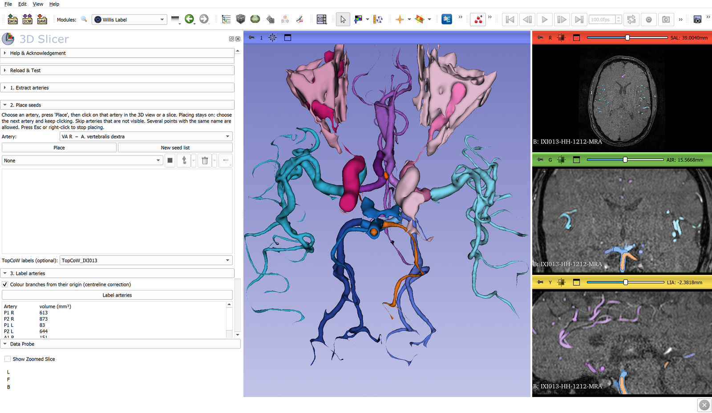

# SlicerWillisLabel

> **Status: work in progress.** Validated on one TOF-MRA case so far; multi-case validation on the public IXI dataset is under way. Not yet submitted to the Slicer Extensions Index.



*IXI013 (IXI dataset, CC BY-SA 3.0), viewed from below. The arteries were labelled automatically with TopCoW classes as seeds and no manual points. The pale segments are side branches that received no seed (`ICA rami`), including orbital fat attached to the ICA. The orange branch on the left is a known error: the left SCA was absorbed into the BA because it had no seed.*

A 3D Slicer extension that extracts the intracranial arteries from a **TOF-MRA** volume and labels them anatomically:

- vertebral, basilar and internal carotid arteries
- PICA, AICA, SCA, anterior choroidal artery
- the segments of the circle of Willis: **A1, AComA, A2, P1, PComA, P2**, and the MCA

Every branch is coloured **from its origin** (not only from where it leaves the parent's silhouette), and each artery can be exported as a separate STL for 3D printing.

Intended uses: anatomy teaching, 3D printing, and research on **anatomical variations** of the intracranial arteries (circle of Willis configuration, fetal PCA, A1 hypoplasia, PICA/AICA origin, etc.).

## Workflow

1. **Extract arteries**: hysteresis thresholding (thresholds are suggested automatically from the intensity histogram), light Gaussian smoothing, removal of small islands and flat sheets (bright subcutaneous fat on TOF). The result is an ordinary segmentation, so you can refine it in Segment Editor.
2. **Place seeds**: choose an artery from the list (`VA R`, `BA`, `ICA L`, `A1 R`, `AComA`, `P1 L`, `PComA R`, …), press *Place* and click on it in the 3D view or a slice. Placing stays on, so choose the next artery and keep clicking. Skip arteries that are not visible. Several points with the same name are allowed for long or tortuous arteries.
3. **Label arteries**: every artery voxel is assigned to the artery whose seeds are closest **along the vessel** (geodesic distance on the 26-connected voxel graph). A centreline-based correction then re-assigns the first millimetres of each side branch from the parent trunk (VA, BA, ICA) to the branch itself. Voxels not connected to any seed go to an `Unconnected` segment.
4. **Export**: one STL per artery (LPS, mm).

Segment names use Terminologia Anatomica (Latin) with the usual abbreviation, e.g. `A. cerebri anterior dextra, pars precommunicalis (A1) [A1 R]`.

Side branches that received no seed are not merged into their parent trunk. They are collected in a separate, paler segment such as `ICA R rami`.

## Recommended workflow: branches named by the anatomist

1. **Extract arteries** (as above).
2. **Split into branches**: the artery tree is cut at its bifurcations (voxel coding on the geodesic distance from the inflow vessels, no skeleton library); every branch gets a number and a colour. A thin side branch (at most 0.65 × the calibre of the vessel it leaves) does not cut the trunk, so the BA or the ICA stays one piece past its small branches and ends at its true fork (P1s; MCA/ACA). Loops such as the circle of Willis are handled.
3. **Name branch**: choose a name and click on a branch. Branches given the same name are merged into one segment. Unnamed branches stay numbered. Every naming is logged on the segmentation node (`WillisLabel.names`).
4. Optional **Suggest names from TopCoW**: branches lying mostly inside a TopCoW class get that name as a pale suggestion (`MCA R ?`); a name given by the user is never overwritten.
5. **Keep named arteries only**: makes a clean segmentation (`<volume> – named arteries`) with one segment per named artery, called by its anatomical name (e.g. `A. basilaris [BA]`); unnamed branches are left out. It is opened in Segment Editor and used for STL export. The numbered branches stay hidden, so you can name more and press it again.

No TopCoW model or Docker is needed for this workflow. The automatic naming described below remains available as an advanced option.

## Optional: TopCoW labels as automatic seeds

A multiclass circle-of-Willis segmentation from a [TopCoW](https://topcow24.grand-challenge.org/) model can be used instead of, or together with, manual seeds. Press **Load file…** next to *TopCoW labels (optional)* and choose the model output (`.mha` / `.nii.gz`); it is loaded as a label map and selected. Then:

- Each TopCoW class seeds the corresponding artery. TopCoW's PCA is split into **P1/P2** at the PComA junction, and its ACA into **A1/A2** at the AComA junction.
- The labels are propagated along the vessels to the distal branches.
- Add manual seeds only for vessels TopCoW does not label (VA, SCA, AICA, PICA).
- The report lists which circle-of-Willis segments are visualised: A1, AComA, third A2, PComA and P1, on each side.

The TopCoW models are not distributed with this extension. They are published by the TopCoW organisers as Docker images ([Zenodo 15665435](https://zenodo.org/records/15665435)). If you use them, please cite the TopCoW challenge paper ([arXiv:2312.17670](https://arxiv.org/abs/2312.17670)).

## Faint distal branches

On TOF the signal of distal branches fades (in-plane saturation), so a branch can break into pieces that are not connected to the seeded tree. With *Connect faint distal branches* (on by default) each thin isolated piece is joined to the tree along its brightest route, if the new part is at most 25 mm long and brighter than 0.75 × the mask's low intensity. Thick isolated pieces (usually fat) are not joined. On IXI002 this doubled the labelled arterial volume more than 40 mm behind the AComA (515 → 988 mm³).

## Superior cerebellar arteries

TopCoW has no SCA class. An unseeded basilar branch is named **SCA R / SCA L** if it leaves the basilar artery at most 10 mm below the P1 junction, runs at least 6 mm laterally and does not run in front of the basilar artery. Lower basilar branches (AICA level) are not named. A manual `SCA` seed always takes precedence.

## Distal ACA: pericallosal course and median vessels

After labelling, the A2 territory is analysed by **course** and **origin**. The corpus callosum is not visible on TOF, so a *pericallosal course* is approximated as reaching at least 10 mm posterior and 8 mm superior to the AComA.

- The posterior-coursing vessel of each A2 is labelled **A. pericallosa** of that side. The A2 keeps its name up to the genu, and its other (anterior / upward) branches become `A2 R rami` / `A2 L rami`.
- A further posterior branch that leaves the pericallosal artery after the genu is shown as a branch but not named, and is not counted as a separate vessel.
- A third posterior-coursing vessel is named by its origin: from the AComA → **A. callosa mediana** (TA98 A12.2.07.032); from an A2 → *pericallosal variation branch* of that A2.
- A single pericallosal artery is reported as a possible azygos or bihemispheric ACA.
- All variation findings are flagged `VARYASYON – anatomist onayı gerekli` (variation, anatomist review required).

## Correcting labels (anatomist in the loop)

Automatic labels are a proposal. In *4. Correct labels*, choose the correct name, press **Pick branch** and click on the wrong branch near its origin. Everything downstream of the click that carries the same (wrong) name is renamed; other labels further on are not touched, so a wrong trunk can be fixed without renaming its correct branches. Correct proximal errors first. *Undo last correction* reverts up to five steps. Every correction is listed in the report and stored on the segmentation node (attribute `WillisLabel.corrections`), so corrected cases can later serve as validation data.

## Notes and limitations

- **"Not visualised" is not "absent".** Slow-flow or sub-millimetre vessels (often AComA or a hypoplastic PComA) may not appear on TOF. Arteries left without a seed are listed as *not seeded*, not as missing.
- The slab may not cover the origins of the VA, PICA or ICA, and variations there cannot be assessed.
- Only `numpy` and `scipy` are used; no extra Python packages need to be installed.

## Roadmap

- [x] Circle of Willis visualisation summary from TopCoW labels
- [ ] Variation report per case: circle of Willis completeness, fetal / partial-fetal PCA, A1 hypoplasia or aplasia (left/right ratios), AComA/PComA visualisation, VA dominance, PICA origin
- [ ] Validation on IXI TOF-MRA cases (CC BY-SA 3.0) and sample data
- [x] Screenshot and Turkish tutorial (`Docs/kilavuz`)

## Development

The algorithms in `WillisLabel/WillisLabelLib/core.py` do not depend on Slicer and are tested with plain pytest:

```
pip install -r requirements-dev.txt
pytest tests
```

## License

MIT (see `LICENSE.txt`).
